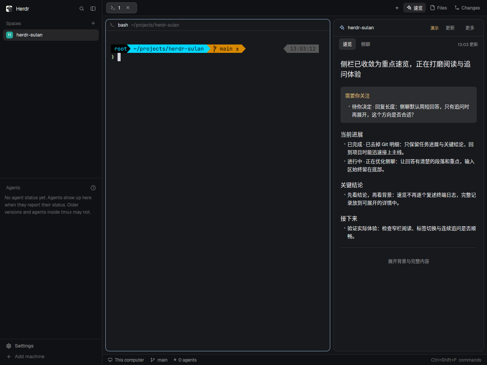

# Herdr · 速览 Sulan

Herdr 原生项目侧边栏。回到项目时，先看清**当前结论、工作进展、需要你决定的事和下一步**，再围绕这些重点继续提问。



预览来自隔离的 Herdr 原生窗口，内容为合成演示数据。[查看侧聊原生截图](docs/preview-chat.png)。

## 侧栏体验

- **速览 / 侧聊**两个标签。切换只构建当前内容，不重建隐藏的回答、摘要或终端列表。
- **重点速览**：一句话结论置顶，需要关注的问题单独突出；正文使用原生 Markdown 渲染粗体、行内代码、段落和列表。长摘要的背景与完整内容默认收起。
- **独立侧聊**：先回答问题，再给简短解释。多行输入框固定在底部；历史对话按需展开，模型设置默认收起，支持复制、重试与 Thinking 折叠。
- **不采集 Git 明细**：不执行 Git 命令，不显示分支、提交、diff 或文件数量。信息来自当前项目的任务线索与有限终端片段。
- 按 Space 保存速览和对话，标签切换保留未发送的草稿。Herdr 标签栏仍支持「速览 / Files / Changes」开关。

## 安装

需要 Herdr App、herdr-core (`hc`) 和 Node.js 22+。没有 npm 运行依赖。

```sh
git clone https://github.com/DylanLIiii/herdr-sulan.git
cd herdr-sulan
npm run install-layout
herdr-app check ~/.config/herdr-app/mods/sulan
herdr-app do layout.switch --name sulan
```

安装器创建独立个人布局，右栏默认 396px；已有同名文件时拒绝覆盖。更新时可使用新名称预览：

```sh
git pull
node scripts/install-layout.js --name sulan-v2
herdr-app check ~/.config/herdr-app/mods/sulan-v2
herdr-app do layout.switch --name sulan-v2
```

也可把 `mods/sulan` 复制到不存在的目标目录，再作为右侧分屏打开：

```sh
herdr-app do pane.split '{"direction":"right","mod":"sulan"}'
```

部分 Herdr 版本不会自动将新 Mod 停靠到自带布局，个人布局或上面的分屏命令可以直接使用。

## 模型与资料

默认网关为 `http://127.0.0.1:3425/v1/messages`，模型为 `auto/deepseek-v4.1-flash`，请求头使用本地网关约定的占位值 `magpie`。

安装后可在 `~/.config/herdr-app/layouts/sulan.json` 中找到 `role: "sidebar"` 对应的 `content.props`，配置 `endpoint`、`apiKey` 和 `summaryModel`。如设置 `HERDR_APP_HOME`，布局文件位于该目录下。真实密钥只保留在个人配置中。

侧聊模型在「侧聊 → 模型设置」中选择。候选列表是 `mods/sulan/chat.js` 的 `DEFAULT_MODELS`；程序不自动继承 Pi/Claude 的模型。Anthropic 请求暂不传递 Effort；非默认 OpenAI 兼容请求会发送 `reasoning_effort`。

初始加载只恢复已有速览和任务线索，不自动请求模型。点击「更新」时收集终端片段并请求 AI 提炼重点；「更多 → 重新整理」从当前资料重新总结。定时检查每 10 秒采集一次线索，不调用模型。任务有新变化时提示手动更新，不自动改写你正在阅读的 AI 摘要。

AI 摘要和侧聊会把速览、任务线索与终端片段发送到配置的模型端点。资料不是完整会话历史；没有证据时不能确认任务已验证或代码已落盘。侧聊只做解答，不执行工具。

每个 Mod 副本使用自己的 localStorage。独立的分屏副本不保证同步。请求 60 秒后会释放 UI 并忽略迟到回复；底层原生 fetch 不支持取消，端点仍应设置自己的超时。请求超时后暂停自动采集，可手动重试。

## 开发

```sh
npm run check
npm test
herdr-app check mods/sulan
```

测试包含真实 View 的模拟宿主回归：仅渲染活动标签、Markdown 文档、固定输入区、草稿保留、按需历史、无 Git 采集，以及终端读取并发。模拟宿主的元素数量不等同于实际帧耗时；原生截图与交互仍需在目标版本核验。

构建配方见 [RECIPE.md](mods/sulan/RECIPE.md)。项目自有部分采用 [MIT](LICENSE)；来源说明及 Herdr Apache-2.0 适配许可见 [THIRD-PARTY-NOTICES.md](THIRD-PARTY-NOTICES.md)。
