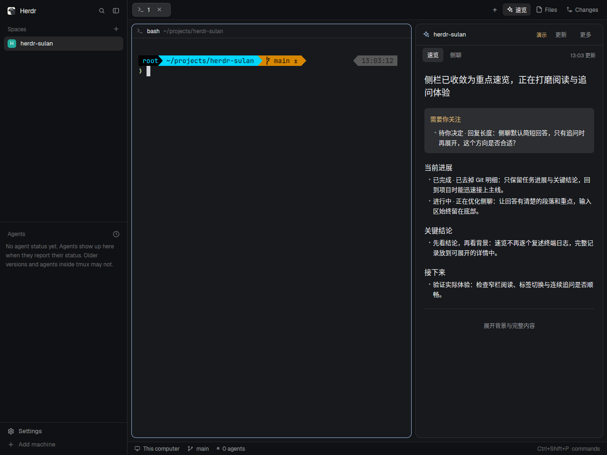

# Sulan · focused project sidebar

A native Herdr sidebar for understanding the current project quickly and asking a follow-up without leaving its terminals.

## Surface

The standard workspace keeps its terminals, Files and Changes. The Sulan toggle opens a 396px sidebar; `mod.json` requests 420px when independently docked. The sidebar contains two tabs: **速览** (brief) and **侧聊** (conversation).

The brief leads with a clear 18px conclusion, followed by a highlighted attention region when there is evidence of a decision or problem. Native `TextView.markdown` renders current progress, key conclusions and the next step in regular 13px text with 21px leading. Bold phrases and inline code carry emphasis. Background and the full older summary are disclosed only on request. There is no terminal statistics page or progress percentage.

The conversation shows the latest question and a Markdown answer, with previous turns collapsed by default. A multiline composer stays outside the transcript's scroll region at the bottom. Model and effort controls are tucked into settings; copy, retry and clear remain available. Thinking is collapsed. A long answer must not push the input out of view.

Use Herdr theme tokens, flat reading sections and restrained borders. Avoid arbitrary rainbow headings, per-line native text elements and nested message cards.

## Data and behavior

- `context.js` selects the active Space and collects bounded screen excerpts from up to four agents using parallel `hc read` calls. It does not execute Git, scan files or collect diffs/commit counts.
- The model prompt merges task evidence into a short result-oriented brief. It does not invent user decisions from a terminal's `blocked` status. Terminal titles alone do not prove completed validation.
- Click Update to synthesize with the configured model. Rebuild is in More and leaves the visible summary in place until a replacement succeeds. Background collection every 10 seconds does not call the model.
- `main.js` owns state and request generation guards. Switching tabs changes only the active surface. `view.js` builds only that surface; no hidden summary, diagram, transcript or terminal panel is materialized.
- `brief.js` prepares Markdown hierarchy once when the summary changes. The old summary parser remains compatible with existing stored six-section summaries.
- Each surface has its own stable scroll id. The multiline draft lives in retained `TextareaState`, survives tab switches, and submits with Ctrl/Command+Enter or Send. Ordinary typing only invalidates the outer sidebar when the Send button changes enabled state.
- Space switches invalidate late context/model replies, clear transient UI state and restore that Space's summary/chat. localStorage belongs to the particular Mod copy. Request deadlines release loading state and ignore late replies; native fetch itself cannot be cancelled.

## Implementation

- `layouts/sulan.json` is a personal adaptation of Herdr's default workspace with a `panel-body` Sulan child.
- `main.js` defaults to sidebar mode. The same Mod with `role: "tabs"` delegates the workspace tab bar to `workspace.js`, adapted under Herdr's Apache-2.0 license.
- `view.js` uses GPUI `Button`, `TextView`, `Textarea` and a scroll area with an adjacent `Scrollbar`. All callbacks use their own `cx`; retained text state is created in init.
- `chat.js` handles prompts and separates returned Thinking from final answers; `llm.js` supports Anthropic/OpenAI-compatible endpoints. Default: `http://127.0.0.1:3425/v1/messages`, `auto/deepseek-v4.1-flash`. Model requests transmit the selected context to that endpoint.
- `demo.js` contains synthetic concise content. Do not publish captured real terminal transcripts as preview data.
- `scripts/install-layout.js` copies every runtime module and license, refuses existing names and rewrites asset paths for custom names.

## Verification

Run `npm run check`, `npm test` and `herdr-app check mods/sulan`. Use an isolated home/core/display for native visual checks. Check summary and chat at 396px and 300px, long answers, keyboard activation, loading/failure/retry, rich text and draft preservation. Native initial-render checks do not replace those interactions.

The regression host counts actual View calls and element descriptions. Its counts demonstrate eliminated hidden work, not a measured end-to-end frame time. Preserve the active-only rendering test when adding features.
